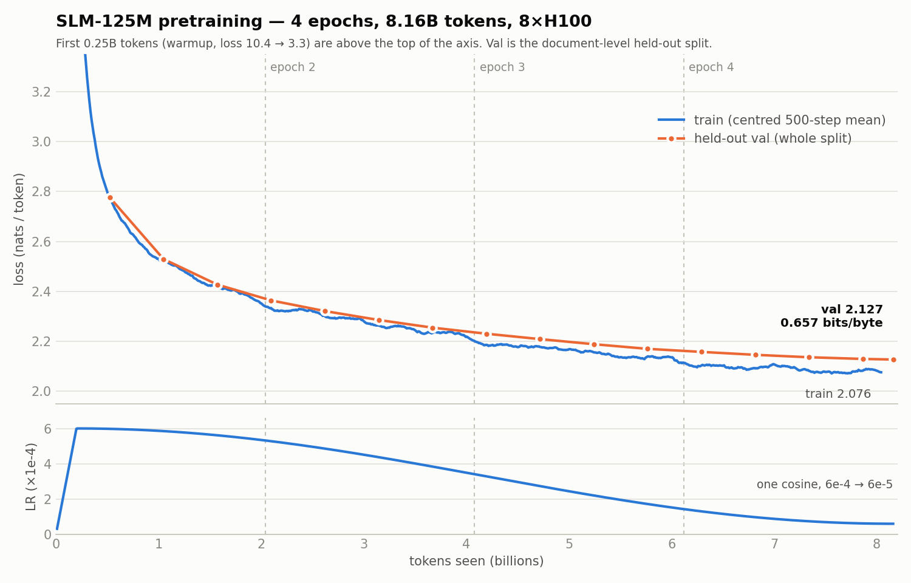

# Phase 5 — Pretrain the 125M model

**Compute:** GPU (H100) · **Cost:** the only real spend in the project ·
**Status:** ✅ **DONE** — Step 1 ($0) · Step 2 (≤ $0.54) · Step 3 (≤ $24.78) · Phase 5 total **≤ $25.32 of $50**

This is the approval document. Spend is approved against what is written here,
so every number below is derived from measured artifacts, not assumptions.

---

## 0. Approved parameters (2026-10-03)

| Parameter | Value |
|---|---|
| Epochs | **4** (one continuous cosine schedule, never restarted) |
| Budget cap | **`--max-usd 50`** (`config.BUDGET_CAP_USD = 50.0`) |
| Full-run hardware | **8 × H100** (H100 SXM5, $0.001097 / GPU-second) |
| Publish target | `Deepanshu027/slm-125m-base` (the requested `mdeepanshu` namespace does not exist on HF; see `docs/06-deploy.md`) |

## 1. Preflight — verified

`verify_model.py`, run `ap-332ROS5YsJCefQATzAq5S1` (against the v2 document-split data),
exits non-zero on any violation.
Result: **ALL INVARIANTS HOLD.**

| Invariant | Measured |
|---|---|
| Exact parameter count | **125,848,320** = `config.MODEL.approx_params()` |
| Embedding / non-embedding | 12,582,912 / 113,265,408 |
| Embeddings tied | True |
| Master weight dtype | `torch.float32` |
| Token ids (tokenizer = `model.py`) | bos 0 · eos 1 · pad 2 · unk 3 — all match |
| `<\|bos\|>` occurrences in packed data | **0** across all 2,059,666,432 tokens |
| `<\|eos\|>` occurrences | 663,469 train + 6,622 val (vs 663,486 / 6,638 docs; the rest sit in discarded tail buffers) |
| Val bytes/token (`skip_special_tokens=True`) | **4.669241** (case-law 4.480 · sec 5.044 · fineweb 4.293) |
| Val split | **document-level** — 6,638 whole documents (0.991%), 19,577,856 tokens |

## 2. Run size

| | Value |
|---|---|
| Train tokens per epoch | 2,040,088,576 (from `/data/tokens/index.json`, v2 document split) |
| Tokens seen (4 epochs) | **8,160,018,432** (15,564 × 524,288; the 328 windows left after the last full step are unused) |
| Global batch | 524,288 tokens = 32 seq × 1024 × 8 GPUs × **2 grad-accum** |
| Optimizer steps | **15,564** — `config.pretrain_steps()`, derived from the index |
| Warmup | 200M tokens = **381 steps** (2.4% of the run) |
| LR | 6e-4 peak → 6e-5 floor, cosine over all 15,564 steps |
| Tokens / parameter | **64.8** (Chinchilla-optimal is ~20) |

Training length comes from one place: `PRETRAIN_EPOCHS × train_tokens` via
`pretrain_steps()`. `TARGET_TOKENS` is now commented as a Chinchilla reference only.

4 epochs sits at the edge of the useful range for repeated data: Muennighoff et al.
(2023, *Scaling Data-Constrained Language Models*) find up to ~4 epochs is nearly
as good as fresh tokens, with returns falling off sharply beyond. Since this corpus
is fixed at 2.04B unique tokens, 4 passes is a reasonable way to spend the budget —
but it makes an honest validation set more important, not less (see §11).

## 3. Cost — read this before approving

Training FLOPs ≈ `6 × N × D` = 6 × 125,848,320 × 8,160,354,304 = **6.162 × 10¹⁸**.
Because GPU-seconds = FLOPs ÷ (MFU × per-GPU peak), **total cost depends only on
MFU, not on GPU count** — more GPUs buy wall-clock, not savings:

```
cost(4 epochs) ≈ $7.860 / MFU      (H100 $0.001097/GPU-s, × 1.15 CPU/memory overhead)
```

| MFU | Cost | Wall-clock on 8×H100 | vs $50 cap |
|---|---|---|---|
| 10% | $78.60 | 130 min | ❌ over |
| 15% | $52.40 | 87 min | ❌ over |
| **15.7%** | **$50.00** | 83 min | **break-even** |
| **16.2%** *(reference repo, measured)* | **$48.52** | 80 min | ⚠️ **3% margin** |
| 20% | $39.30 | 65 min | ✅ 21% margin |
| 25% | $31.44 | 52 min | ✅ |
| 30% | $26.20 | 43 min | ✅ |

**The honest read:** at the only *measured* MFU we have (16.2%, from the reference
repo), 4 epochs fits under $50 with a 3% margin ($48.52). A 1-point MFU shortfall pushes it
over and the budget guard would stop the run partway through. **The run is
affordable only if throughput is at or above the reference** — which is why the
performance stack (§4) and the calibration step (§10) decide this phase.

Cost per hour on 8×H100 including overhead: **$36.33**.

## 4. Performance stack — recommendation and why

**Recommended: SDPA attention + fused AdamW + TF32 matmuls as the baseline, with
`torch.compile` A/B-tested during calibration and kept if it is faster and resumes
cleanly. Skip flash-attn 2.**

Where the FLOPs go, per layer, forward, seq 1024:

| Block | GFLOP | Share |
|---|---|---|
| MLP (SwiGLU) | 14.50 | **64.3%** |
| QKVO projections | 4.83 | 21.4% |
| Attention scores + AV | 3.22 | **14.3%** |

- **Skip flash-attn 2.** Attention is only 14% of FLOPs, and PyTorch's SDPA already
  dispatches to a fused flash kernel on H100. The remaining gain is small, and
  building the flash-attn wheel is the most fragile step an image build can have.
- **Try `torch.compile`.** At hidden size 768 the matmuls are cheap, so the unfused
  elementwise work around them — RMSNorm, the SiLU gate, RoPE, residual adds — is a
  large share of step time. Fusing that is exactly what compile does, which makes its
  usual 1.2–1.8× gain unusually valuable for a model this narrow:

  | Gain over 16.2% | MFU | 4-epoch cost | Margin under $50 |
  |---|---|---|---|
  | 1.0× (no gain) | 16.2% | $48.52 | 3% |
  | 1.2× | 19.4% | $40.43 | 19% |
  | **1.3×** | **21.1%** | **$37.32** | **25%** |
  | 1.5× | 24.3% | $32.35 | 35% |

  Its risks — 1–3 minutes of compile time, and occasional recompiles on resume —
  are exactly what the < $1 calibration can expose before any real money is spent.
- **Fused AdamW** (`fused=True`): in a 125M model the optimizer step is a
  non-trivial share of each step; the fused kernel removes per-parameter launches.
- **TF32** for any fp32 matmul that escapes autocast.

## 5. Precision

- **Never** `model.to(torch.bfloat16)`. Master weights stay **fp32**; the AdamW
  state is fp32.
- Forward and backward run under
  `torch.autocast(device_type="cuda", dtype=torch.bfloat16)`.
- **Why it matters:** bf16 has an 8-bit mantissa, so near 1.0 its spacing is
  2⁻⁷ ≈ 0.0078. An AdamW update of lr × ~1 = 6e-4 is far below half that spacing,
  so on bf16 weights it rounds away to nothing — RMSNorm gains initialised at 1.0
  would stay frozen at exactly 1.0 for the entire run, and every other weight would
  lose most small updates the same way. fp32 master weights keep the updates.

## 6. Token ids and prompting

- `config.json` and `generation_config.json` set **`bos_token_id=0`, `eos_token_id=1`,
  `pad_token_id=2`** explicitly from `model.py` — never LlamaConfig defaults
  (Llama defaults are bos 1 / eos 2, which would be off by one here).
- **Prompts start with `<|eos|>`, not `<|bos|>`** (`model.PROMPT_PREFIX_TOKEN_ID`).
  Measured above: BOS never appears in the training data, so its input embedding
  is untrained. Every training document begins immediately after an EOS, so EOS is
  the prefix that matches what the model actually learned. `config.json` still
  records `bos_token_id=0` because that is the true vocabulary entry; the sample
  generator (Phase 5) and the server (Phase 6) prepend EOS explicitly. This is the
  same convention GPT-2 uses, where `<|endoftext|>` is both separator and prefix.

## 7. Metrics

Logged every 20 steps; evaluated on the full val split every 1,000 steps.

| Metric | Formula | Why |
|---|---|---|
| loss | mean token cross-entropy, nats | the optimised quantity |
| perplexity | `exp(loss)` | conventional, but **tokenizer-dependent** |
| **bits-per-byte** | `loss × 0.308978` | `loss / (ln 2 × 4.669241)` — **tokenizer-independent**, comparable to models with any vocabulary |
| tokens/sec, MFU | `6 × N × tok/s ÷ (n_gpus × 989e12)` | the cost driver |
| spend, projected spend | `config.projected_cost_usd()` | budget guard |

The 4.669241 constant is the measured ratio of the v2 (document-level) val split.
If the val split is ever rebuilt, it must be re-measured — `verify_model.py` does that.

## 8. Checkpoint, resume and schedule continuity

Modal preempted containers **twice during Phase 4 alone**, so preemption is
designed for, not hoped against.

- `/data/checkpoints/ckpt.pt` every **500 steps**: model, optimizer, step, data
  position (epoch + offset), and RNG states. Written to a temp file and renamed
  (atomic), then `volume.commit()`.
- **The LR is a pure function of the global step**, so a resume after preemption
  continues the *same* cosine schedule from the same point. This satisfies the
  "one continuous schedule, no re-warming" rule automatically: a preemption is a
  pause, not a restart.
- Per-epoch shuffle is seeded `seed + epoch`, so resuming mid-epoch reproduces the
  same order and skips exactly the windows already consumed.
- Worst-case loss per preemption: 500 steps ≈ 262M tokens ≈ 2.6 min of 8×H100 ≈ $1.6.
- Final artefact: `/data/checkpoints/base/` — `config.json`, `model.safetensors`,
  `generation_config.json`, tokenizer files. Metrics: `/data/checkpoints/metrics.jsonl`.

## 9. Budget guard (`--max-usd 50`)

From step 20 onward the trainer projects total spend from **live** throughput:
`projected = spent_so_far + remaining_steps × measured_sec_per_step × rate`. If
`projected > max_usd` it **checkpoints first, then exits cleanly** with the
projection in the log. It also hard-stops if actual spend crosses the cap. Because
the projection is live, a run that will not fit is stopped within its first few
dollars rather than near the end.

## 10. Execution plan — three steps

### Step 1 — Local smoke test · Mac M2 Pro · **$0**

**Goal:** prove the data loader, forward/backward, loss, logging and
checkpoint save → resume round-trip before any GPU exists.

- Full model geometry, **20 steps**, micro-batch 2, run on MPS (or CPU), **fp32**.
- Data: 2 val shards copied locally (~3 MB each; same `.bin` format as train).
- Kill at step 10, resume, and confirm step, LR and data position continue exactly.
- Pass: loss finite and falling, checkpoint reloads bit-exact, resume is seamless,
  saved `config.json` carries bos 0 / eos 1 / pad 2.

**What it cannot test:** CUDA bf16 autocast, fused AdamW, NCCL/DDP and compile-on-CUDA
exist only on GPU. Those are first exercised in Step 2.

### Step 2 — Calibration · 1 × H100 on Modal · **< $1**

**Goal:** replace the assumed MFU with a measured one.

- **50 steps**, real recipe, bf16 autocast — run twice: without and with
  `torch.compile` (~$0.30 each).
- Records tokens/sec, MFU, peak memory, compile time, and a resume test.
- **Decision rule.** Single-GPU MFU is an *upper bound* for 8 GPUs (DDP adds
  communication), so allow ~15% for scaling loss:

  | 1×H100 projected 4-epoch cost | Action |
  |---|---|
  | ≤ $42 | proceed to Step 3 (scaling loss still fits under $50) |
  | $42 – $50 | stop and report — too close to call |
  | > $50 | **do not launch**; return with options (3 epochs, higher cap, more tuning) |

### Step 3 — Full 4-epoch pretraining · 8 × H100 on Modal · **~$37–48**

- **15,564 steps**, 8.160B tokens, one cosine schedule over the whole run.
- `--max-usd 50` with the live guard from §9, so the real 8-GPU throughput is
  checked within the first minutes — if it does not fit, it stops early,
  checkpointed, not at $49.
- Expected: ~43–80 min wall-clock depending on measured MFU.
- On completion: write HF `base/`, run final val eval, and generate samples from a
  legal and a financial prefix, each prompted with `<|eos|>`.

## 11. Document-level validation split — ✅ APPROVED AND DONE (2026-10-03)

**Resolution:** Phase 4 was rebuilt with a document-level split (`docs/04-tokenize.md`, v2).
6,638 whole documents (0.991%) are held out; every document is on exactly one side.
All numbers in this doc refer to the v2 data. The original reasoning is kept below.

Phase 4 sends every 100th **window** to val. Documents span windows, so the rest of
each val document is in training:

| Source | Avg windows per document | What a val window's siblings look like |
|---|---|---|
| sec | 18.8 | ~18 sibling windows of the same filing are in train |
| case-law | 3.4 | ~2–3 sibling windows in train |
| fineweb-edu | 1.1 | mostly self-contained |

This follows the spec and matches the reference, so perplexity stays comparable
to it. But it makes val perplexity optimistic, and "held-out" overstates it.

**4 epochs makes this materially worse.** With 4 passes over the ~18 sibling
windows of each SEC val filing, the model increasingly *recalls* that specific
filing — names, figures, phrasing — so SEC val loss measures recall rather than
generalisation. And the signal multi-epoch training most needs is the one this
destroys: overfitting shows up as val loss rising while train loss falls, but a
val set that shares documents with train tends to fall *with* it. A leaky val set
would hide exactly the failure 4 epochs risks.

**Recommendation: rebuild Phase 4 with a document-level split before Step 3.**
~10 minutes of CPU, ~$0; the tokenizer is unchanged. Each document goes wholly to
val when `blake2b(text) % 100 == 0`, train and val pack into separate buffers, and
`pretrain_steps()` re-derives the step count from the new index automatically.
(It must use `blake2b`, not Python's `hash()`, which is salted per process — the
same hazard noted for `dedup.word_ngrams`.)

Trade-off: it modifies `modal_app.py`, one of the four verbatim GUIDE files, and
replaces the recorded Phase 4 artefacts — so it needs an explicit yes.

## 12. Validation criteria

1. Loss falls without divergence; grad-norm stays bounded; no NaN/Inf.
2. Val loss, perplexity and BPB reported at each 1,000-step eval; final BPB is the
   headline, tokenizer-independent number. (Not MMLU — near-random at 125M.)
3. Train/val gap tracked across all 4 epochs as the overfitting signal.
4. A resume from `ckpt.pt` demonstrated to continue at the correct step and LR.
5. `/data/checkpoints/base/` loads with `AutoModelForCausalLM.from_pretrained` and
   carries bos 0 / eos 1 / pad 2.
6. Coherent domain samples from legal and financial prefixes, prompted with EOS.
7. Total spend ≤ $50.

## 13. Files

| File | State |
|---|---|
| `config.py` | ✅ amended: 4 epochs, $50 cap, GPU rates, `pretrain_steps()`, `projected_cost_usd()`, exact `approx_params()` |
| `model.py` | ✅ written: factory, explicit token ids, `PROMPT_PREFIX_TOKEN_ID = EOS` |
| `verify_model.py` | ✅ written and run: preflight invariants, fails loudly |
| `data.py` | ✅ written: memory-mapped windows, per-epoch seeded shuffle, step-derived layout |
| `train.py` | ✅ written: fp32 master + bf16 autocast, fused AdamW, cosine, BPB, live guard, atomic ckpt |
| `pretrain_app.py` | ✅ written, **not yet run**: 1×H100 calibration + 8×H100 run, both refuse without `--confirm` |
| `smoke_local.py` | ✅ written and passed: the Step 1 harness, 31 assertions |

---

## ⛔ Approval required

- **Step 1** ($0) — no approval needed; proceeds on the go-ahead to build.
- **Step 2** (< $1, 1 × H100) — needs explicit approval.
- **Step 3** (~$37–48, 8 × H100, `--max-usd 50`) — needs explicit approval *after*
  Step 2's measured MFU is reported against the decision rule in §10.
- ~~§11 document-level split~~ — **approved and done** 2026-10-03.

## Results

### Step 1 — local smoke test ✅ PASSED (2026-10-03, $0)

`.venv/bin/python smoke_local.py` on the M2 Pro: **31/31 checks passed** in 36 min.
It ran on CPU in fp32, using one val shard as a stand-in train set (1,129 windows)
and another as val (1,522). Smoke settings: micro-batch 1, 2,048-token batch,
`--warmup-steps 5`. Torch 2.5.1 and transformers 4.46.3 are the same pins as the
GPU image.

| Block | What was proven |
|---|---|
| **A. Unit checks (10)** | Warmup reaches 6e-4 at step 380 and the LR never rises again; it ends exactly at 6e-5. Each epoch is a full permutation with a different order. **A step reads the same windows for any (GPU count, micro-batch) with the same batch size.** Ranks and micro-steps never overlap. The real run is 15,564 steps, with grad-accum 2 on 8 GPUs and 16 on 1 GPU. |
| **B. Reference run (7)** | 20 steps; loss goes 9.896 → 7.867 (mean of last 5). Step 1 is near ln(16384) = 9.70, as expected for a random init. One metrics row per step; status `max_steps`; samples generated. |
| **C. Crash test (7)** | SIGKILLed at step 13, resumed from the step-10 checkpoint. **Every per-step loss and LR matched the uninterrupted run exactly (max diff 0.0), and the final weights are bit-identical.** Metrics were truncated on resume, so no step appears twice. |
| **D. DDP (3)** | `torchrun --nproc_per_node=2` (gloo): world 2, accum 1, and per-step losses identical to the single-process run (max diff 0.0). This confirms the rank-disjoint layout and gradient averaging. |
| **E. HF export (7)** | All 6 files present. `config.json` and `generation_config.json` both carry **bos 0 / eos 1 / pad 2**. `from_pretrained` loads 125,848,320 params with `lm_head` re-tied, the exported tokenizer has `<\|eos\|>` = 1, and the bf16 export agrees with the fp32 weights on **100%** of next-token argmaxes. |

**Samples after 20 steps** are word salad (*"the the the, the the I, to in the in
that of…"*), and both prompts produce the same text. That's expected: after 20
tiny steps the model has learned only word frequencies, so the prompt barely
changes the distribution, and the same seed gives the same draws. This only
proves the generation path works.

**Not exercised locally (CUDA-only):** bf16 autocast, fused AdamW, NCCL, and
`torch.compile` on CUDA. Step 2 is the first run that touches these.

### Bug found and fixed during Step 1

- `dist.ReduceOp.AVG` exists only on NCCL. Under gloo the loss logging would have
  crashed, so it now uses SUM ÷ world. A single 8×H100 run on NCCL would not have
  hit this, but the local DDP test would have.
- Warmup is derived as 200M tokens ÷ batch size, which at the 2,048-token smoke
  batch is 97,656 steps, so the LR would never have left ~1e-8. Added
  `--warmup-steps` (default 0 = derived), so the real run is unchanged at 381.

### Step 2 — calibration on 1 × H100 ✅ PASSED (2026-10-03, ≤ $0.59)

App `ap-dLOwu1cjUEPeqepSG0vaVy`, one container, three sequential torchrun launches.
The app was up for 7 min 46 s (15:07:36 → 15:15:22 IST), which bounds the cost at
466 s × $0.001097 × 1.15 = **≤ $0.59**. Modal's billing report had not caught up
yet (0 rows). The trainer's own ledger says $1.04, because it charges a 120 s
startup allowance on each of the 3 launches even though they shared one warm
container. It errs high on purpose.

| Run | Steps | tok/s | **MFU** | 4-epoch cost at this MFU | Val loss / BPB @ 50 |
|---|---|---|---|---|---|
| eager | 0 → 30 | 199,615 | 15.2% | **$51.67** ❌ over cap | — |
| eager, **resumed** | 30 → 50 | 199,319 | 15.2% | — | 7.4970 / 2.3164 |
| **`torch.compile`** | 0 → 50 | **424,826** | **32.4%** | **$24.28** ✅ | 7.4969 / 2.3164 |

**What this settles**

- **`torch.compile` is required, not optional.** Eager mode measured 15.2% MFU,
  essentially the reference repo's 16.2%, which would put 4 epochs at $51.67 and
  over the cap. Compile gives **2.13× the throughput** and brings 4 epochs to $24.28.
  This confirms the §4 analysis: in a model this narrow, the small unfused ops
  around the matmuls were the bottleneck.
- **Compile does not change the model.** Train loss is identical to 4 decimals at
  every logged step (9.7311, 9.2586, 8.5294, 8.2398, 7.8830, 7.5506 at steps
  5/10/20/30/40/50), and val loss differs by 0.0001.
- **Resume works on CUDA**, including fused-AdamW optimizer state. The eager run,
  stopped at 30 and resumed, logged step-40/50 losses (7.8830, 7.5506) identical to
  the uninterrupted compiled run. LR at step 40 was 6.30e-5 = 6e-4 × 40/381, still
  on the original warmup ramp.
- **All CUDA-only paths are now exercised:** bf16 autocast, fused AdamW, NCCL
  under torchrun, compile on CUDA, HF export, sample generation. No warnings,
  recompiles, graph breaks or non-finite values anywhere in the log.
- **Overheads measured:** staging the 4 GB of tokens to local disk took 20 s;
  checkpoint saves took 2.9–5.6 s.
- Samples at 50 steps are still word salad (*"of the the the of the…"*), as expected.

**Decision rule (§10):** 1-GPU projection $24.28 ≤ $42 → **PROCEED** to Step 3,
subject to approval.

### Projection for Step 3 (8 × H100, compiled)

Single-GPU MFU is an upper bound for 8 GPUs. Here the per-step gradient all-reduce
(~503 MB of fp32 grads over NVLink) takes a few milliseconds, against roughly 155 ms
of compute per GPU per step, so scaling losses should be small. Planning range:

| 8-GPU scaling efficiency | MFU | Training cost | + fixed overhead* | **Total** | Wall-clock |
|---|---|---|---|---|---|
| 95% | 30.8% | $25.6 | ~$4 | **~$30** | ~45 min |
| 85% | 27.5% | $28.6 | ~$4 | **~$33** | ~50 min |
| 70% (pessimistic) | 22.7% | $34.7 | ~$4 | **~$39** | ~60 min |

\*Fixed overhead: container start, token staging, compile (~1 min), 31 checkpoints
at ~4 s each, 16 full-val evals, final export and samples.

**Cap for Step 3:** `--max-usd 49`, i.e. $50 minus Step 2's ≤ $0.59, rounded down,
so Phase 5 as a whole stays under the approved $50. The live guard re-projects from
real 8-GPU throughput after 20 steps; if 8-GPU MFU unexpectedly fell below ~16%, it
would checkpoint and stop within the first few dollars.

### Pre-launch final review (2026-10-03)

Scope: what 1 GPU and 50 steps could *not* prove: branches that never executed,
behaviour that appears only with 8 processes, and stale state on the Volume.

| Check | Result |
|---|---|
| Static scan (pyflakes) of all Phase 5 modules | No undefined names in any branch; one unused import removed |
| Volume state | `/data/checkpoints` holds only `calibration/`; no stale `ckpt.pt` / `spend.json` / `metrics.jsonl`, so the run starts at step 0 |
| Collectives under 8 ranks | Every all-reduce, broadcast and barrier is gated on `done`, which is identical on every rank, so no rank can wait on a collective the others skip |
| Paths already proven on CUDA | DDP over the compiled module, `no_sync` accumulation, fused-AdamW resume, bf16 eval, export |
| **Budget-stop branch (had never run)** | Exercised locally with `--gpu H100 --max-usd 0.10`: it stops at step 1, **checkpoints before exiting**, exits with code 3, writes `budget_stop`, and skips the export. A relaunch resumes from that checkpoint, and **the spend ledger carries across launches** ($0.164 → $0.187, launches = 2), so preemption restarts keep counting toward the cap |

**Fixed before launch:** the 8-GPU function relied on Modal's default host request
(0.125 core, 128 MiB). Meanwhile inductor starts up to 32 compile workers per rank,
each importing torch, which could mean ~256 processes and an OOM kill (and a
restart loop) during the first-step compile, something a single-rank calibration
cannot show. Now: `cpu=16.0, memory=96 GiB` (4.8% of GPU cost, inside the 15%
overhead factor) and `TORCHINDUCTOR_COMPILE_THREADS=4`.

**Launch command:** `modal run --detach pretrain_app.py::pretrain --confirm --max-usd 49 --compile`

### Step 3 — full 4-epoch pretraining on 8 × H100 ✅ COMPLETED (2026-10-03)

App `ap-fvlUMayCRdesCVr8xelPEv`, launched with
`modal run --detach pretrain_app.py::pretrain --confirm --max-usd 49 --compile`.
Status `completed`, exit code 0, steps 0 → 15,564 in one launch, with no
preemptions, restarts or warnings.



#### Headline

| | Value |
|---|---|
| **Final held-out loss** | **2.1269 nats/token** (whole document-level val split, 19.56M tokens) |
| **Final held-out perplexity** | **8.39** |
| **Final held-out bits/byte** | **0.6572** (tokenizer-independent) |
| Final train loss (centred 500-step mean) | 2.076 |
| Tokens seen | 8,160,354,304 (4 epochs, 64.8 tokens/param) |
| Throughput | **3.36M tok/s**, MFU **32.1%** median (32.5% peak), i.e. **~99% scaling** from the 1-GPU 32.4% |
| Wall-clock | **44.9 min** container lifetime, including start-up, staging, compile, 16 evals, 31 checkpoints, export and samples |
| **Cost** | **≤ $24.78** (44.9 min × 8 × $0.001097 × 1.048 measured host share). The trainer's ledger says $27.82 because it budgets a 1.15 overhead factor and a 120 s start-up allowance on purpose |

Projected vs actual: the plan said $30–39 and 45–60 min; the result was ≤ $24.78 and
44.9 min. 8-GPU scaling was near-perfect, better than the 85–95% planning assumption.

#### Every evaluation (whole held-out split)

| Step | Epoch | Tokens seen | Train loss | Val loss | Val ppl | **Val bits/byte** | Gap |
|---|---|---|---|---|---|---|---|
| 1,000 | 1 | 0.52B | 2.726 | 2.7763 | 16.06 | **0.8578** | +0.050 |
| 2,000 | 1 | 1.05B | 2.510 | 2.5294 | 12.55 | **0.7815** | +0.019 |
| 3,000 | 1 | 1.57B | 2.397 | 2.4271 | 11.33 | **0.7499** | +0.030 |
| 4,000 | 2 | 2.10B | 2.346 | 2.3637 | 10.63 | **0.7303** | +0.017 |
| 5,000 | 2 | 2.62B | 2.260 | 2.3210 | 10.19 | **0.7172** | +0.061 |
| 6,000 | 2 | 3.15B | 2.232 | 2.2854 | 9.83 | **0.7061** | +0.054 |
| 7,000 | 2 | 3.67B | 2.213 | 2.2546 | 9.53 | **0.6966** | +0.041 |
| 8,000 | 3 | 4.19B | 2.167 | 2.2303 | 9.30 | **0.6891** | +0.063 |
| 9,000 | 3 | 4.72B | 2.149 | 2.2087 | 9.10 | **0.6824** | +0.059 |
| 10,000 | 3 | 5.24B | 2.100 | 2.1883 | 8.92 | **0.6761** | +0.088 |
| 11,000 | 3 | 5.77B | 2.120 | 2.1697 | 8.76 | **0.6704** | +0.049 |
| 12,000 | 4 | 6.29B | 2.089 | 2.1575 | 8.65 | **0.6666** | +0.069 |
| 13,000 | 4 | 6.82B | 2.036 | 2.1458 | 8.55 | **0.6630** | +0.110 |
| 14,000 | 4 | 7.34B | 2.060 | 2.1360 | 8.47 | **0.6600** | +0.076 |
| 15,000 | 4 | 7.86B | 2.108 | 2.1293 | 8.41 | **0.6579** | +0.021 |
| 15,564 | 4 | 8.16B | 2.053 | 2.1269 | 8.39 | **0.6572** | +0.074 |

(The train loss in this table is a single 20-step log at that step, so the gap
column is noisy. The chart uses a centred 500-step mean.)

#### Did 4 epochs overfit? No — but the returns diminished

- **Held-out loss improved at all 16 evaluations**; it never turned upward. That's
  the overfitting test the document-level split was built for, and it would have
  been hidden with v1's leaky window split.
- **Train loss drops a step at every epoch boundary** (visible in the chart): the
  model is partly memorizing documents it has seen before. Held-out loss shows no
  such step, so that memorization never cost generalization.
- **Diminishing returns are clear.** Per-epoch improvement in held-out bits/byte:
  epoch 1 → 0.7499 (from 0.8578 at step 1k), epoch 2 → 0.6966 (−0.053),
  epoch 3 → 0.6704 (−0.026), epoch 4 → 0.6572 (−0.013). Each pass bought about half
  the gain of the previous one. A 5th epoch would likely add < 0.01 bits/byte, so
  this corpus is close to exhausted at 125M parameters. More unique data, not more
  epochs, is the lever for the next model.

#### Samples (from the run, prompted with `<|eos|>`, temperature 0.8, top-k 50, top-p 0.95)

> **The court held that the defendant**’s failure to file a statement of claim for the
> $5,000 bond with the plaintiff’s counsel on or before February 9, 2003, did not
> prevent the plaintiff from filing a lawsuit against the defendant. The court
> reasoned that the defendant’s failure to file a claim for the bond with…

> **The Company's net revenues for the fiscal year** ended January 31, 1998 were
> $298,384,000 as compared to net revenues of $262,906,000 for the fiscal year ended
> January 31, 1997 ("fiscal 1997"). The net loss for fiscal 1997 was $35,917,000 as
> compared to net…

#### Independent verification of the exported artifact

`/data/checkpoints/base/` was downloaded and checked locally with plain
`AutoModelForCausalLM.from_pretrained`, so this checks the file, not the run's
own report:

- 125,848,320 params; `lm_head` tied to `embed_tokens`; `config.json` **and**
  `generation_config.json` carry bos 0 / eos 1 / pad 2; weights bf16, 251.7 MB.
- Held-out loss re-measured on 48 random windows of the case-law val shard:
  **2.1259**, against the run's pooled **2.1269**. They agree.
- The fineweb-edu val shard scores **3.04** (ppl 21), much worse. That's the expected
  shape of a 77%-legal model. Note that per-source bits/byte must use that
  source's own bytes/token: fineweb ≈ **1.02**, case-law ≈ **0.685**, against the
  pooled **0.6572**, which is correct only for the pooled split.
- Fresh samples:
  - *"Pursuant to Section 10(b) of the Securities Exchange Act of 1934,"* →
    *"the Registrant has duly caused this report to be signed on its behalf by the
    undersigned, thereunto duly authorized…"* (word-perfect 10-K boilerplate)
  - *"The Supreme Court of the United States has long recognized that"* →
    *"the separation of powers between branches of government is a fundamental
    principle of our system of government…"*
  - *"Photosynthesis is the process by which"* → *"plants produce more oxygen, carbon
    dioxide and water from the sun…"* (**fluent but false**). This is the
    honest limit of a 125M base model trained 77% on legal/financial text: it
    speaks the domain register well and does not know general facts reliably.

**Defect found and fixed:** the exported `config.json` had **no `architectures`
field**. `from_pretrained` tolerated it (it falls back on `model_type`), but vLLM
and llama.cpp's GGUF converter read `architectures[0]` and would fail in Phase 6.
The cause: the config came from a model built from a config object, where
`architectures` is unset. The fix is in `train.py` (`export_hf` sets it from the model
class), and the already-exported `config.json` on the Volume was patched to
`["LlamaForCausalLM"]` and re-verified with a round-trip load. No retraining was
needed; the weights are untouched.

#### Validation criteria (§12)

| # | Criterion | Result |
|---|---|---|
| 1 | Loss falls without divergence; bounded grad-norm; no NaN/Inf | ✅ grad-norm settled at 0.17–0.25; no non-finite values |
| 2 | Val loss / ppl / BPB at each 1,000-step eval | ✅ 16 evals; final 2.1269 / 8.39 / **0.6572** |
| 3 | Train/val gap tracked across 4 epochs | ✅ val improved every eval; no overfitting |
| 4 | Resume demonstrated | ✅ bit-exact locally (Step 1), on CUDA (Step 2); not needed in Step 3 (no preemption) |
| 5 | `base/` loads via `from_pretrained` with bos 0 / eos 1 / pad 2 | ✅ verified independently; `architectures` fixed |
| 6 | Coherent domain samples, EOS-prompted | ✅ legal and SEC register fluent |
| 7 | Total spend ≤ $50 | ✅ **≤ $25.32** for Phase 5 |
